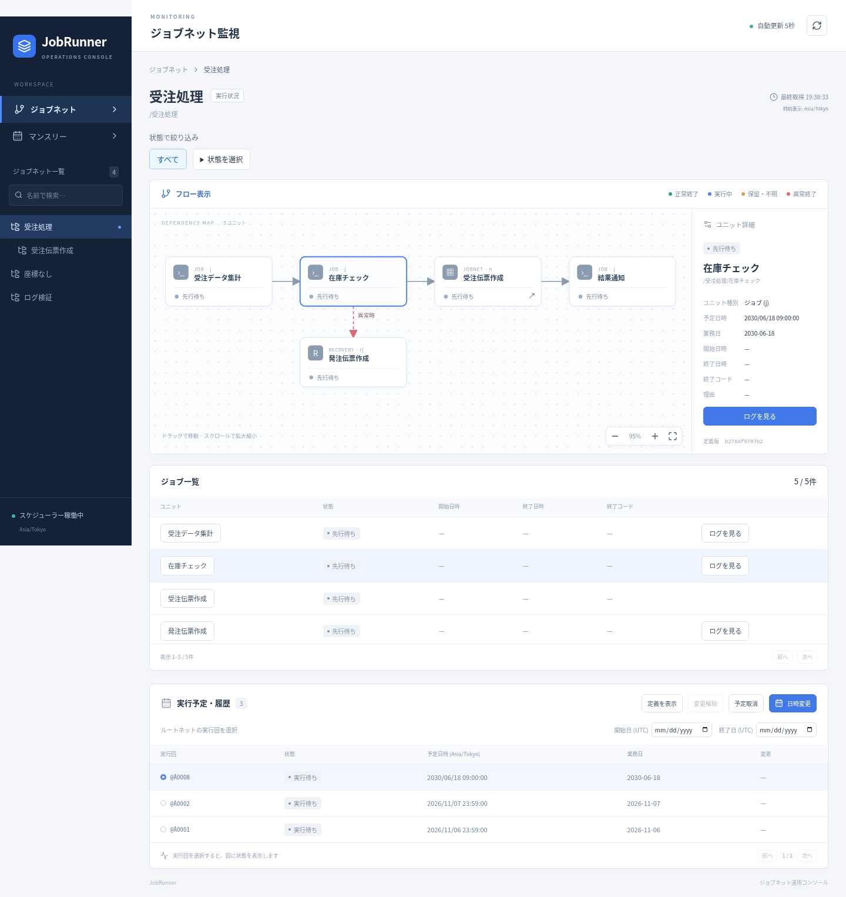
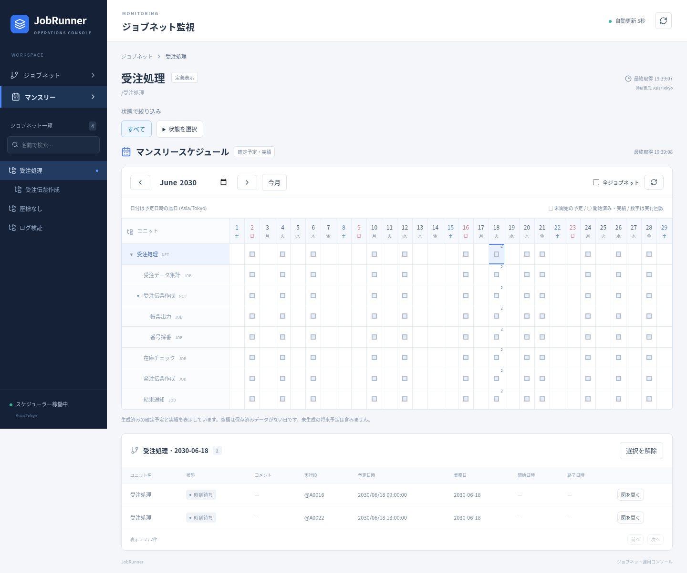
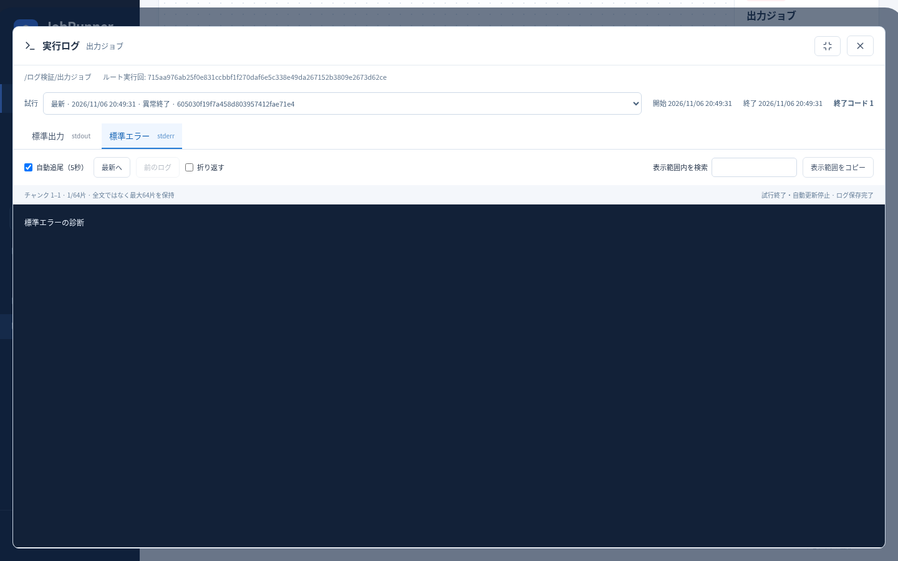
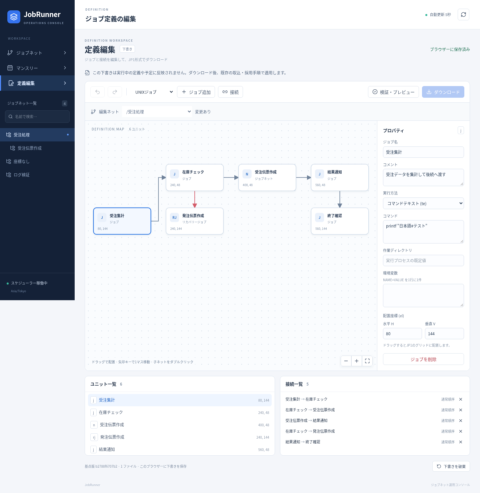

# JobRunner

.NET 10 / ASP.NET Coreで動く、JP1/AJS3 V12定義を入力とする非公式のジョブスケジューラーです。Web APIと運用・定義編集用Web UIを提供し、同じマシン上のプロセスを実行します。状態はAzure Blob/Table Storageへ保存します。

**実装計画全体は未完了です。** 現在の実装・テスト済み範囲と未達項目は [検証結果](docs/verification-results.md)、JP1仕様との対応は [互換表](docs/compatibility-v12.md) を参照してください。完全互換や業務処理のexactly-onceは保証しません。

## 画面でできること

ジョブネットの依存関係と実行状態をSVGで表示します。ジョブを選ぶと予定・開始・終了日時や終了コードを確認でき、子ネットへ移動できます。状態は5秒ごとに更新します。



マンスリースケジュールでは、階層と日付を並べて生成済みの確定予定・実績を確認できます。日付セルを選ぶと同日の実行回が下の一覧に表示され、そこから実行状況の図を開けます。



ジョブの「ログを見る」から、標準出力・標準エラーを試行（再実行）ごとに確認できます。下部パネルは拡大でき、5秒ごとの自動追尾、停止、前のログ取得、折り返し、表示範囲内検索・コピーに対応します。大量ログは末尾から読み、画面には最大64チャンクを保持します。



状態を複数選択すると、図の接続を保ったままジョブ一覧を絞り込み、月間では該当ユニットと祖先を表示します。結果不明と異常終了は別々に選択できます。

ルート実行回を選ぶと、開始前の日時変更・予定取消・変更解除を行えます。未生成の将来予定の予測は対象外です。画面は認証なしで利用できます。

「定義編集」では採用中の定義から下書きを開き、SVG上でジョブを移動・接続し、フォームで名前・コマンド・引数・作業ディレクトリ・環境変数を変更できます。通常ルートと子ネットn/rnの作成、既存ネットの改名・子孫を含む削除、j/pj/rj/rpと判定ジョブjdj/rjdjの追加・削除、元に戻す・やり直すに対応します。判定は24方式の条件・範囲・保留を編集できます。実行属性フォームではジョブの保留・終了判定・しきい値・打ち切り時間、ネットの保留・多重起動・遅延監視、LocalAgentsの対応付け名を編集できます。省略と明示値を区別し、リモート実行やOSユーザー切替は行いません。下書きはブラウザーへ自動保存され、再読込後も続けられます。



「検証・プレビュー」で変更前後の原文と診断を確認し、JP1形式でダウンロードします。コメント・未編集の属性・文字コード・BOMを保持し、複数入力は配置情報付きZIPになります。画面から採用・実行は行わず、適用には既存の取込・採用手順を使用します。ZIPの`manifest.json`に各ファイルの元のBlobパス・配置先・文字コードを記録します。適用時はその対応で原文を配置してください。開始日・時刻・周期・振替・起算・上位ルール参照と、既存グループのカレンダーも編集できます。属性の省略と明示値、複数ルールを区別して保持します。種別変換と階層移動は現在の対象外です。

「グループ・Unitファイルを作成」から、同じ原文のグループまたは配置先へ空グループを追加できます。新規Unitファイルはローカル下書きだけに追加でき、ファイル名・配置先・文字コード・BOM・初期グループを明示します。「新規ローカルファイルで開始」は確認後に現在の下書きを置き換えます。新しいグループもネットの親やカレンダーの編集対象になります。作成はundo/redo・保存復元に対応し、遅い検証応答や別タブの保存で編集を上書きしません。グループの改名・削除・移動は未対応です。[作成画面](docs/spec/scheduler/web-ui/images/creation-editor.png)を参照してください。

新規ルートは既存の原文ファイルとグループを選び、予定なし（sd=0,ud）・保留あり（ha=y）で作成します。保留は実行属性フォームから解除できます。子ネットは親と同じファイルへ追加し、リカバリーネットは子としてのみ作成できます。別ファイルの配置先になっているネットの改名・削除は拒否します。ファイルの最後のユニットを削除した場合は、同じファイルに代替ユニットを作成するまで出力できません。[ネット編集画面](docs/spec/scheduler/web-ui/images/network-editor.png)と[仕様・制限](docs/spec/scheduler/web-ui/spec.md)を参照してください。

「スケジュール・カレンダー」では、原文に属性を指定するか省略するかを選べます。ルートの開始日省略は登録日基準であり、予定なしは`0,ud`です。カレンダーの継承・参照を使った下書きの予定試算は、仮の登録基準日と業務日の期間を明示して行います。これは未登録の候補で、採用済みの実行予定とは異なります。ネスト単独の試算や間隔登録の予測は含めません。画面例は[スケジュール編集画面](docs/spec/scheduler/web-ui/images/schedule-editor.png)、未対応のカレンダー境界は[互換表](docs/compatibility-v12.md)を参照してください。

「ローカル定義を開く」ではUnitファイルをまとめて選び、各ファイルの文字コード・元ファイル対応・論理配置先を指定できます。UTF-8、UTF-16LE/BE、Shift_JISに対応し、BOMと指定が違う場合は拒否します。JobRunner出力ZIPは対応表を使用します。最大32ファイル・各2MiB・合計8MiB（ZIP単独8MiB、展開後も同じ上限）、64階層・各10000ユニットです。原文は検証のためサーバーへ送信しますが保存せず、ブラウザー下書きに保持します。置換前の確認、複数タブ競合検出、失敗時の現在の編集保持を行います。汎用ZIP、別形式Schedule/Calendar、ディレクトリ読込は対象外です。[ローカル入力の画面](docs/spec/scheduler/web-ui/images/local-files-editor.png)を参照してください。

[Web UIの起動手順](#web-ui) / [予定変更などの画面画像](docs/spec/scheduler/web-ui/spec.md#画面イメージ) / [UIの検証記録](docs/spec/scheduler/web-ui/verification.md)

## バックエンドのビルドとテスト

.NET 10 SDK、Node.js 22、npm、Python 3、curlがあるLinux環境で実行します。Node.jsはUIの開発・ビルドとAzuriteのテストに使用します。本番アプリの実行依存ではありません。

```bash
./scripts/verify.sh
```

Azurite 3.35.0を一時領域へ導入し、Blob/Tableの起動確認、Releaseビルド、StyleCop解析、xUnit、テスト検出数の確認まで実行します。10000〜10002番ポートは空けてください。実Azureの契約・資格情報は不要です。統合テストはアプリを実OSプロセスとして2つ起動し、リース失効を待つため約1分以上かかります。Azurite未起動時のテストスキップはありません。

Web UIの型検査・単体試験・Playwrightの手順は[Web UI](#web-ui)を参照してください。CIでは両方を実行します。

既存Azuriteへ接続してテストする場合:

```bash
dotnet restore JobRunner.slnx
dotnet build JobRunner.slnx -c Release --no-restore
dotnet test JobRunner.slnx -c Release --no-build
```

## 起動

Azuriteを起動し、Azure Storage Explorer等で`jp1-definitions`コンテナーに次の2ファイルを配置します。

| ローカルファイル | Blob名 |
| --- | --- |
| `examples/daily.txt` | `jobs/daily.txt` |
| `examples/calendar.txt` | `calendars/business.txt` |

```bash
export JobRunner__ConnectionString='UseDevelopmentStorage=true'
export JobRunner__DefinitionSources__0__Kind=Unit
export JobRunner__DefinitionSources__0__TargetPath=/業務/日次
export JobRunner__DefinitionSources__0__BlobPath=jp1-definitions/jobs/daily.txt
export JobRunner__DefinitionSources__1__Kind=Unit
export JobRunner__DefinitionSources__1__TargetPath=/
export JobRunner__DefinitionSources__1__BlobPath=jp1-definitions/calendars/business.txt
export JobRunner__ScheduleTimeMode=48
export ASPNETCORE_URLS=http://127.0.0.1:5080
dotnet run --project src/JobRunner --no-launch-profile
```

稼働系だけが入力一式を検証し、ルートネットを自動確定登録します。入力がない・不正・未対応の場合、APIは起動しますがスケジューラーは`Faulted`となり実行しません。サンプルはLinux用です。PCジョブ（`ty=pj`）もLinux上のコマンドとして実行できます。Windowsの実機検証は未実施です。

計画実行登録はユーザー指定により対象外です。確定登録に未来世代数（1〜99）の指定と自動補充、ネット一式の日時変更・即時化・取消・強制終了・TOP再実行を追加しました。

実装済みの範囲は、履歴・ログ・操作要求の保持期限処理、失敗ジョブ再実行時の祖先ネット復帰、所有者付き定義ヘッダー、JP1形式の即時登録・保留変更APIです。1,000実ジョブの集中負荷も全テストに含めています。

## 構成と運用

- [実装計画（提供原文）](docs/implementation-plan.md)
- [現行仕様と受入条件](docs/spec/scheduler/spec.md)
- [設定・API・障害復旧](docs/operations.md)
- [JP1 V12対応表](docs/compatibility-v12.md)
- [検証結果・未達項目](docs/verification-results.md)

本体は1つのcsproj、xUnitテストは別の1つのcsprojです。API認証、リモート実行、SQLite、Quartz、Hangfireは導入していません。

## Web UI

`src/JobRunner/clientapp` に監視・定義編集画面を同梱しています。JP1定義のel座標を使ってReactのSVGでジョブネットを表示し、状態取得にaspidaの生成クライアントと`@aspida/swr`を使用します。認証はありません。実行ログの参照・状態絞り込み、ルート実行回の日時変更・予定取消・変更解除と、前述の定義の下書き編集を提供します。

.NET 10 SDKとNode.js 22.12以降を用意し、初回は依存関係をインストールします。Storageと入力定義の設定は上記の起動手順と共通です。

```bash
cd src/JobRunner/clientapp
npm ci
cd ..
dotnet watch run
```

Viteは自動起動します。`http://localhost:5173`を開くと、`/api`を.NETの5080番へプロキシします。APIポートを変更する場合は`JOBRUNNER_API_URL`も合わせてください。Swagger UIは開発時の`http://localhost:5080/swagger`です。

APIを変更した場合は、次の順序でスキーマとクライアントを更新します。スキーマ出力ではSchedulerWorkerを起動せず、Storageには接続しません。

```bash
cd src/JobRunner/clientapp
npm run export-api
npm run generate-api
npm run lint
npm run format:check
npm test
npm run build
```

実APIと専用Azuriteを使用するブラウザ試験:

```bash
dotnet build JobRunner.slnx -c Release
cd src/JobRunner/clientapp
npx playwright install chromium
npm run test:e2e
npm run screenshots
```

試験は11300〜11302・5181・5174番ポートと一時ディレクトリを使用します。実Azureは使用しません。`PLAYWRIGHT_CHROMIUM_EXECUTABLE`で既存Chromiumを指定できます。画像は[Web UI仕様](docs/spec/scheduler/web-ui/spec.md)から参照できます。通常試験では文書画像を上書きせず、`screenshots`で明示更新します。

```bash
dotnet publish src/JobRunner -c Release -o artifacts/publish
cd artifacts/publish
dotnet JobRunner.dll
```

publish時にフロントエンドをビルドし、`wwwroot`へ同梱します。配信サーバーにNode.jsは不要です。APIと画面は同じ.NETホストから配信されます。

図の表示には親ネットの `el=ユニット名,種別,+H +V;` が必須です。座標がない・不正な場合は図にエラーを表示します（ジョブ実行には影響しません）。ELKによる自動配置は行いません。マンスリー画面では、サービスのタイムゾーンで日付ごとに生成済みの確定予定・実績を表示します。セルを選択して一覧を確認し、実行回の図へ移動できます。未生成の将来予定の予測は行いません。
