> 現行の運用反映・Storage共有保存・全体停止・版9の複製/月表示は[定義運用仕様](../definition-lifecycle/spec.md)を参照してください。編集・検証・ダウンロードは運用を変えず、明示的な「運用に反映」操作だけが運用版を更新します。

# ジョブネット運用・定義編集画面

## 目的
運用担当者が現在のジョブネット、実行状態、予定をブラウザで確認し、ルート世代の予定を変更する。採用中のジョブ定義を下書き編集し、検証した原文をダウンロードする。

## 仕様
- 認証なし。定義の下書き編集とダウンロードを提供する。定義上のスケジュール・カレンダー編集と未登録の試算を提供する。共有下書き保存・確認後の運用反映・全体停止/再開は[定義運用仕様](../definition-lifecycle/spec.md)に従う。個別の実行登録やジョブ操作の追加は含めない。
- ReactによるSVGで定義座標を使って依存関係を描画する。パン、ズーム、全体表示、子ネットへの移動、キーボード選択を提供する。
- OpenAPIからaspidaクライアントを生成し、読み取りはuseAspidaSWRを使用する。実行状態は5秒間隔で更新し、配置・選択を維持する。
- 実行回に固定された定義版を使用する。履歴退避済みの結果はBlobから復元する。Unknownを成功・失敗に推測しない。
- 予定変更はルート世代単位でMove(MOVE/SHIFT)、Cancel、Restoreを使用する。受付と完了を区別し、再送時は同じ操作IDと内容を使用する。
- 日時はサービスのタイムゾーンで表示する。日時入力はオフセット付きISO日時を使い、業務日を別表示する。
- 開発時はdotnet watch runからViteを起動し、ViteからAPIをプロキシする。本番は.NETが静的ファイルとAPIを配信する。

## 受入条件
| 条件・操作 | 結果 |
|---|---|
| 分岐・合流・リカバリー・子ネット | SVGの線、矢印、種別が識別できる |
| 状態の再取得 | 配置・選択・ズームを維持する |
| 旧版の実行、退避済みの実行 | 固定定義と元の業務結果を表示する |
| 日時変更・取消・変更解除 | 完了を照会して図と一覧を再検証する |
| 開始済み・応答喪失・再送 | 既存の拒否と冪等性を維持する |
| 通信失敗 | 最後の取得時刻と再取得を表示する |
| publishしたアプリ | Node.jsなしでUIを提供し、未知のAPIは404 |

## 画面イメージ
固定サンプル、Chromium、1440×900。`npm run screenshots`で明示更新する。

- [全体図](images/jobnet-overview.png)
- [実行状態](images/execution-status.png)
- [子ネット](images/nested-jobnet.png)
- [予定変更](images/schedule-change.png)
- [変更結果](images/schedule-change-result.png)

## 定義座標とマンスリースケジュール

- `el=ユニット名,種別,+H +V;` を図の座標の正本とし、自動配置はしない。全直下ユニットに座標が必要。不足、不正、範囲外、同一ユニットへの重複指定、名前・種別不一致は図の取得エラーとし、対象パスと理由を表示する。スケジューラーによる実行や月間一覧は表示座標の有無に依存しない。
- 根拠は[JP1 V12コマンドリファレンス3021-3-D28-20](https://itpfdoc.hitachi.co.jp/manuals/3021/30213D2820/H03D2820.PDF) 5.2.2（pp.1047–1048）。H=0〜16000、V=0〜10000。`sz`は最大アイコン数で、座標そのものではない。JobRunnerは指定された座標の相対位置を保持して表示用に一律1.5倍し、全体表示は実際のノード範囲に合わせる。JP1 Viewの非標準グリッド値の自動補正は実装しない。
- ELKは使用しない。接続先は`ar`、線は固定位置のノード端点を結ぶSVGの直角経路で描画する。他のノードを回避する経路探索は行わない。
- 月間画面は生成済みの確定予定・実績のみ。未生成の将来予定を予測したり、閲覧によって世代を作ったりしない。空欄は「保存済みの予定・実績なし」であり、将来の実行がないことは保証しない。
- 月切替、今月、全ネット/選択ネット、階層の開閉、日付セル選択、複数回実行の件数表示、詳細一覧、実行回の図への遷移を提供する。
- 列の日付はサービスのタイムゾーンで予定日時を暦日に変換する。48時間制の業務日は一覧の別項目。月末・年越し・閏年を扱う。退避済み実績は元の結果を表示し、世代に固定された定義を使う。

受入条件: 座標欠落時の明示エラー、定義順と逆の座標・縦接続の維持、月境界と複数回・取消・退避実績の表示、セルから図へ移動、取得失敗と再取得をAPIとPlaywrightで確認する。

- [マンスリースケジュール](images/monthly-schedule.png)

## 実行ログと状態絞り込み

- 図のジョブ詳細・ジョブ一覧と月間のジョブ実行行から、下部のログパネルを開く。ネットにはログ操作を出さない。選択した実行回は画面や状態絞り込みを変えても保持する。
- 初期表示は最新試行の標準出力。試行・標準出力/標準エラーを切り替え、開始/終了日時・終了コードを確認する。再実行が増えても選択中の試行を変えず、新しい試行の存在を通知する。退避済み履歴・再実行待ちの過去試行にも対応する。
- 実行中は5秒間隔で保存済みログを追尾する。追尾を止めると表示範囲を固定し、「最新へ」で再開する。終了した試行の本文の定期取得を止める。拡大・閉じる・折り返し・表示範囲内検索・表示範囲のコピー・前のログ取得を提供する。ANSI端末や二つのストリームの時系列合成は行わない。
- ログAPIは1応答16チャンクまで、画面は64チャンクまで保持する。初期は末尾を読み、前方ページ・追加分を取得する。全文は読み込まず、表示範囲と上限を明示する。文字列はプレーンテキストとして扱う。
- 未開始（試行なし）、保存済みログなし、保存未完了、通信失敗を区別する。出力ゼロと保持期限による削除は保存形式から区別できないため、断定しない。
- `/api/jobrunner/ui/attempts` と `/api/jobrunner/ui/logs` は採用領域、ルート、実行回、試行の所属を検証する。Blobパスはサーバーで構築する。既存API・履歴・ログ保存形式は変更しない。
- 図と月間で共通の状態複数選択を使う。既定はすべて。結果不明は異常終了と区別する。定義表示では絞り込みを無効にする。図では接続を保ったまま対象外ノードを薄くし、20行単位の一覧からジョブを選択・注目できる。月間では該当行と祖先を残し、件数・記号・詳細を同じ絞り込み結果から作る。

受入検証: 実HTTPで複数試行・再実行待ち・履歴退避・所属不一致・空/未完了ログ・ページ境界と取得上限を確認する。Vitestで表示上限と絞り込みを確認し、実APIを使うPlaywrightでログの入口、試行/ストリーム切替、追尾/停止、拡大、通信復旧、日本語/長行/HTML文字列、状態件数を検証する。画像は `images/` に保存してREADMEにも掲載する。

### ログ・絞り込みの画面

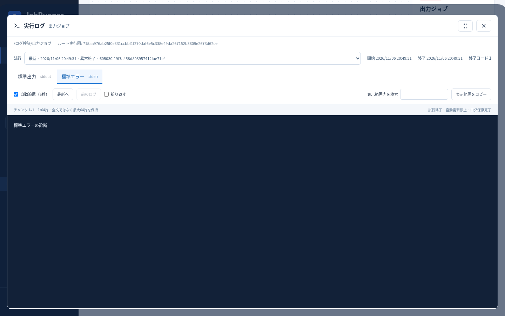

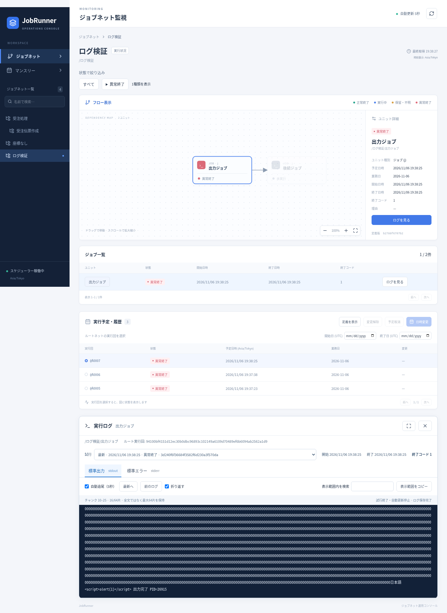

ログAPIの`cursor`は省略時に末尾16片、`before:<連番>`でそれより前、`after:<連番>`でそれより後を返す。境界は含めない。本文は1片32 KiBまで、最大16片を取得する。Blob名の列挙は本文取得とは独立しており、ログ数に比例する。試行一覧は生存中の履歴ではTableの試行一覧を読むため、大量履歴での索引追加は今後の対象とする。

## 定義の下書き編集

- 採用中の保存済み定義またはローカルUnit原文を下書きとして開く。種別変換は現在の対象外。下記のネット階層編集、直下のj/pj/rj/rpの追加・削除・名前・コメント・teまたはsc/prm・wkp・envと、jdj/rjdjを編集する。スケジュール・カレンダーは後述のフォームで編集する。その他の属性と編集しない予定・カレンダーは保持する。
- 図とフォームで編集し、ドラッグはH=80+160x、V=48+96yへ合わせる。未編集の座標は維持し、自動配置しない。必要に応じszを拡張する。接続追加・削除、名前変更に伴うar/el更新、削除時の関連接続の確認、undo/redoを提供する。
- 保存済みmanifestと原文のハッシュを検証する。原文がない/破損している場合はエラーとし、実行モデルから原文を再構築しない。構文位置を使い編集部分だけ置換する。未編集ファイルはバイト列同一、編集ファイルは未編集のコメント・属性・繰り返し順・改行・BOM・元の文字コードを保持する。文字コードで表現できない変更は出力不可。
- Shift_JISは.NET CP932の例外fallbackを使用する。既定のbest-fitデコードなら読める別符号でも、厳格なデコードが拒否する入力は受理しない（例:「≒」の87 90は拒否、81 E0は受理）。非可逆な符号を黙って正規化して出力しない。
- GET `/api/jobrunner/ui/definition-editor` で原文と投影、POST `.../preview` で読取専用の変更前後と検証結果、POST `.../export` で再検証して出力する。いずれも定義を保存/採用せず、登録・世代・試行を変更しない。POSTも生成済みaspidaを使用し、古い検証応答を新しい編集結果に上書きしない。
- 下書きはIndexedDBへ自動保存して再読込で復元する。保存失敗は表示する。編集中に採用版が変わっても元の版を固定し警告する。明示的な破棄で現在の定義に戻る。
- 単一ファイルは元のファイル名・文字コードでダウンロードする。複数ファイルは原文一式と配置/文字コードを記載するmanifestをZIPにする。構文・参照・循環・文字コードの検証エラーではダウンロード不可。座標は実行検証と別に診断し、不足時は図を表示せずフォームから修正できる。

根拠: [JP1 V12 3021-3-D28-20](https://itpfdoc.hitachi.co.jp/manuals/3021/30213D2820/H03D2820.PDF) 5.1.1（unitとコメント）、5.2.2（el/sz）、5.2.4（ar）、5.2.6（te/sc/prm/wkp/envと`#"`/`##`）。原文編集とHTTP・ブラウザー下書きはJobRunner独自機能。実JP1への投入比較は未実施。

受入条件: 無変更出力のバイト一致、日本語/引用符/#/BOM/CRLF/Shift_JIS、複数入力と参照、追加/削除/名前変更/接続/配置、重複/循環/不正接続の拒否、座標修正、undo/redo、再読込復元、古い検証応答の無視、出力の再取込検証、運用データ不変を自動試験で確認する。

### 定義編集の画面

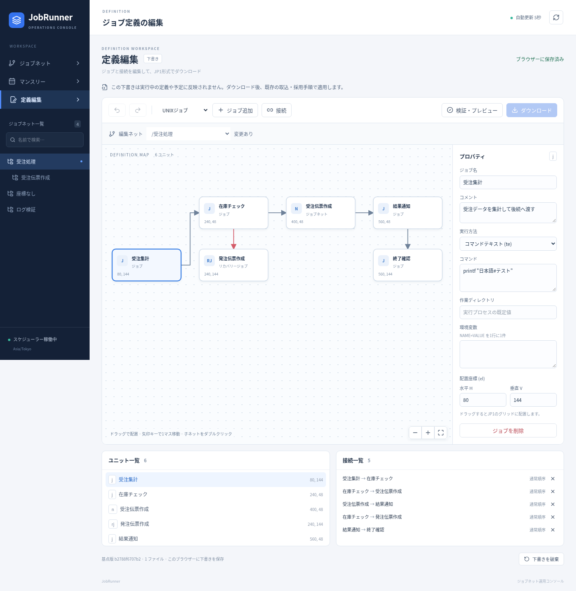

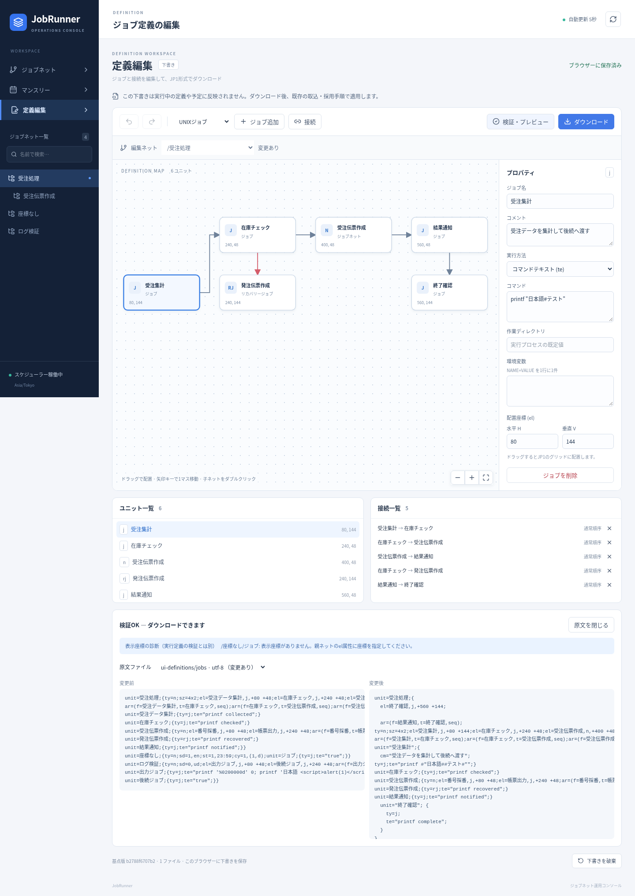

### 下書きの競合と座標境界

- IndexedDBの共通下書きには保存世代を付け、読んだ世代と一致する場合だけ同じreadwriteトランザクションで更新する。同一タブの保存を直列化する。別タブが更新した場合はローカルの編集を保持して自動保存を停止し、検証・出力による退避と保存済み下書きの明示的な再読込を案内する。競合の再試行で無条件上書きしない。既存version=1の保存データは読み出し可能とする。DBのバージョンを2へ更新して旧版タブの接続を閉じ、無条件保存する旧版コードの再接続を拒否する。
- 破棄の再取得を開始した後に編集・undo/redoされた場合、遅い応答でローカル編集や保存内容を置換しない。破棄も保存の世代比較を通し、競合時に他タブの下書きを消さない。
- H=0〜16000/V=0〜10000のフォーム指定は維持し、非グリッド値も原文へ保持する。szはアイコン数1〜100でありピクセル境界ではない。配置変更時の拡張は最大100に収め、座標の合法範囲を狭めない。ドラッグは既存の100列×100行（最大H=15920/V=9552）へスナップし、フォームの10000を自動補正しない。
- 受入: 2ページの保存競合と再読込、同一タブの連続保存、遅延した破棄応答と新しい編集、H/Vの最小・最大・範囲外、sz上限、スナップの上限を回帰試験する。
- 初回の保存領域読み込みが一時的に失敗しても、再読込で空のDBを確認できた場合は現在の編集を保持して保存を再開する。空の確認後に別タブが保存した場合も、保存世代の比較で上書きを防ぐ。初回だけ失敗する読込と、復旧中の別タブ保存を回帰試験する。

### 判定ジョブの編集

- 既存ネット内でjdj/rjdjを追加・削除・名前変更し、コメント、判定方式、判定値、上下限と境界、ファイル名、変数名、保留を編集する。新規は終了コード>0とし、先行との通常接続・従属への条件接続は利用者が指定する。既存の一対一制約・循環・リカバリー制約を共通検証で確認する。種別変換は扱わない。ネット作成は後述のネット階層編集で扱う。
- V12 5.2.8のうち実行器が対応する24判定方式を扱う。数値・ファイル・変数・文字列・有無に応じた入力を表示し、省略と明示値を区別する。空の文字列判定値を保持する。条件変更時も非表示の既存属性は保持するが、ef/nfと併記できないejcを削除する場合は確認し、undoで復元できる。変数受渡しはJobRunner独自JSON方式であり、AJSVAR互換とは表示しない。
- 編集投影にeditorVersion=2を追加する。未指定/1の要求では従来の判定ジョブの読取専用契約を維持し、欠落した判定属性を削除指定として扱わない。旧ブラウザー下書きは現在の採用版ではなく下書きのDefinitionHashの原文から判定属性を補い、既存のジョブ編集・接続・座標を維持する。元版を取得できない場合は旧下書きを保持して自動保存を止め、再読込を案内する。移行も保存世代の比較を通す。
- 原文の未変更部分・文字コード・BOM・改行・ヘッダーを保持する。編集、移行用読取、検証、出力は採用・登録・世代・試行・定義Blobを書き換えず、判定対象ファイルや変数を実際に評価しない。
- 受入: jdj/rjdjの追加・変更・名前交換・削除と接続、全判定方式、数値/文字列/文字コード境界、無変更バイト一致、未編集属性保持、旧下書きと旧API要求、原文取得失敗と復旧、移行中の2タブ競合、保存失敗、undo/redo、ダウンロード後の再解析、運用データ不変を検証する。

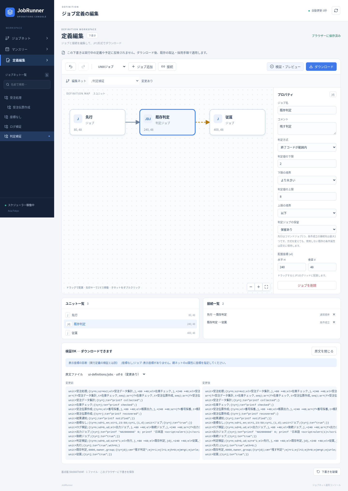

### ネット階層の編集

- 通常ルートn、子ネットn/rnの作成、既存ネットの名前・コメント変更、子孫を含む削除を扱う。リカバリーネットrnのルート作成、既存ユニットの種別変更、階層移動は扱わない。ルートは既存ファイルとその配置先または同じファイル内の既存グループを選んで追加する。子ネットは親のファイルに追加する。
- 新規ルートはsd=0,ud（予定なし）とha=y（保留あり）を初期値とする。版5では実行属性フォームからhaを変更できる。新規の子ネットは独立予定を持たず、親に従う。下書きの作成・検証・出力で採用・登録・実行データを書き換えない。
- 下書きの選択は監視の選択から分け、未採用ネットの編集中に監視画面へ戻っても採用済みの対象を表示する。画面を戻すと編集中の子ネットを維持する。
- 内部の識別子は改名前のパスまたはnew:のIDを保持し、表示用の完全名は親子から算出する。親を改名しても子の編集・接続・undo/redoを維持する。既知のar/el参照だけを更新し、コマンド・コメント中の文字列やカレンダー参照を推測で書き換えない。
- 無変更の原文、ファイル所属、マッピング、文字コード、BOM、所有者ヘッダー、未編集の予定・カレンダー・属性を保持する。ネットを配置先として別ファイルが利用している場合、そのネットと祖先の改名・削除を拒否する。最後のユニットを消して空になるファイルは既存取込仕様で表現できないため、同じファイルへ代替ユニットを作成するまで出力不可とする。
- editorVersion=3でルートの編集投影と追加可能な配置先を導入する。旧版1/2の要求は従来どおり扱い、旧下書きは元ハッシュから不足した情報を補って既存編集を維持する。移行失敗・競合・遅い応答の保護を維持する。
- 受入: ルート/子/リカバリーネット作成、親子の同時改名と編集、名前交換・削除・接続、原文と各文字コード、複数ファイルと配置先、移動・不整合・外部配置の拒否、予定非生成・運用データ不変、旧下書き・競合・再取込・undo/redoを検証する。

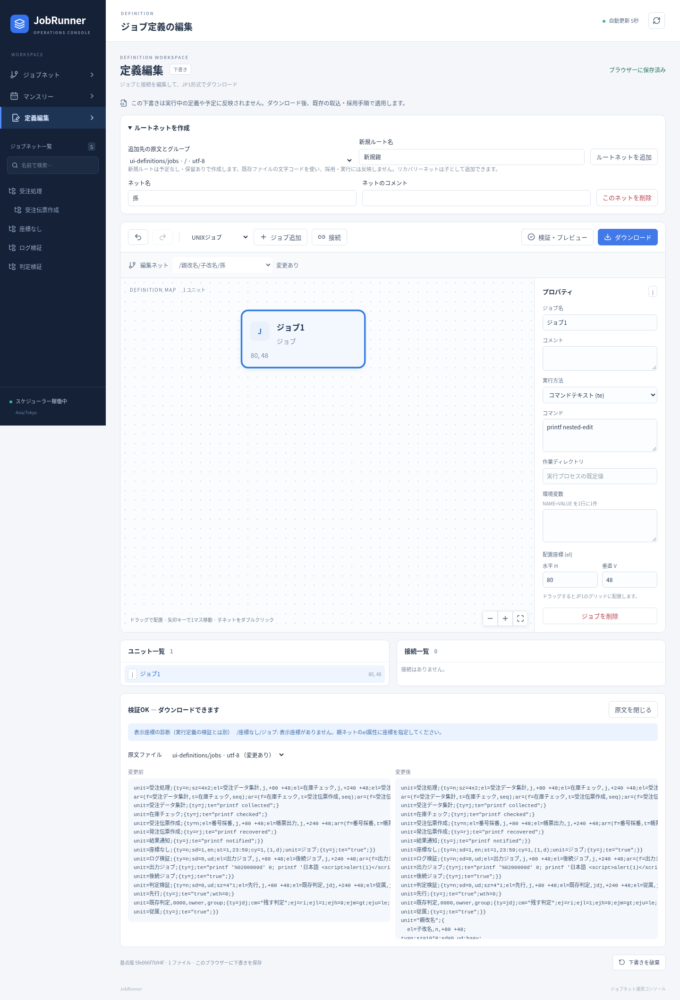

### スケジュール・カレンダーの下書き編集

#### スケジュール簡単設定

- 公式V12 3021-3-D28-20 5.2.3–5.2.4で表現できる毎日・毎運用日・毎週曜日・毎月暦日・毎月第N/最終運用日・指定日一回・毎月暦日から前後N運用日のフォームを提供する。定義属性や計算規則は追加しない。相互変換が確定しない指定は詳細編集を使い、近似変換しない。
- 毎運用日はsd=en/cy=(1,d)/sh=caで表現する。月の運用日番号はsdd/mdによる業務月、毎月25日は暦日である。起算は振り替え後に適用し、起点を含めず前日/翌日から運用日を数える。猶予内に指定数がなければ候補なしとする。
- 新規フォームは09:00、月の指定日は25日、運用日オフセットは後2日・振り替えなし・起算猶予10日とする。他の新規パターンの休業日処理は中止（毎日は実行）を明示する。初期表示だけでは属性を変更せず、JP1省略値を置き換えない。設定可能な時刻は時間制に従う。
- 一つの既存ルールまたは新しい未使用ルールだけを操作する。sy/eyを含めて番号の衝突を避け、他ルール・未編集属性・省略/明示・元バイトを保持する。予定なし0,udからの変更と、全ルールへ影響するjc変更は確認する。haや運用の停止は変更しない。
- 未適用入力と保存済み下書きを区別し、生成属性と説明を表示して既存APIで試算する。適用は一回のundo対象とする。別の下書き変更や対象切替後に古い候補を適用しない。未適用入力の破棄には確認を設け、画面離脱と再読込でも保護する。
- 受入: 毎月25日の後2/前5運用日、連休・猶予不足・振替順序・月年境界・うるう年・業務月・時刻境界を検証する。月末に曜日（年/月/週番号省略）を登録した場合は翌月/翌年の最初の対象曜日から週周期を継続する。複数ルール、詳細編集との往復、undo、保存/復元、競合/遅延応答、原文バイト、出力/再取込を検証する。編集と試算で運用データを変更しない。

- 版4はネットのsd/st/cy/sh/shd/cftd/ln/ed/jc/deと、既存グループのop/cl/stt/sdd/mdを別の属性投影で編集する。グループの追加・削除・改名は含めない。配置先から補われる仮想グループには原文がないため編集対象に出さない。各属性は「指定する」と省略を区別し、繰り返す属性は原文と同じ順序・ルール番号付きの値を保持する。空の明示値は省略へ変換せず診断する。ルールを連番へ振り直さず、他の属性を連動削除しない。
- 省略時の継承・既定値は現行エンジンに委ね、フォームの初期表示で実値を書き込まない。ルートsdの省略は登録日基準であり、予定なしは0,udであることを表示する。新規ルートの初期値は0,udを維持する。de省略/yと独立sdの併用は既存検証で拒否する。lnの上位ルール参照を保持する。
- V12 5.2.3–5.2.4の既存対応範囲を扱う。変更するsd/edの日付・範囲と非引用値の構文を確認し、既存の検証器でルール重複・時刻・周期・参照・ネスト・基準日を検証する。29〜31日/第5曜日の基準日、24時間制で24時以降、夏時間の曖昧・欠落時刻は従来の未対応・拒否を維持する。監視属性sy/ey/fdと保留・多重起動はこのフォームでは編集せず保持する。
- 版1/2/3の要求は従来どおり受理し、旧下書きは元ハッシュから不足する予定/カレンダー投影を補う。版3で新規作成・改名・削除したネットとその編集を維持する。競合・取得失敗・遅い応答の保護は継続する。
- 下書き予定試算は純粋計算のみ。明示した登録基準日と開始/終了業務日（終了は含まない）から、保存済み原文に下書きを適用したルートネットを計算する。1994〜2036年、最大366日・2000候補の画面用制限を設ける。結果の集約前の計算も含め、予定計算段階が5秒を超えたら中断する（原文の読込・検証時間は別）。HTTP要求の取消も計算へ伝える。登録・補充の計算には試算用時間制限を適用しない。超過は部分結果を返さず診断する。ルール番号・業務日・実日時・時間帯を表示し、実行予定・登録済み世代ではないことを明記する。編集または試算条件変更後の遅い応答は表示しない。
- ネスト単独の試算、独自の間隔登録、起動条件・遅延監視・保留状態を考慮した実行予測は含めない。ネストの実行候補は上位世代が必要なため、ルート計算を流用して表示しない。採用・登録・実行・定義Blobを書き換えない。
- 受入: 省略/明示、複数ルール・上位参照、親子改名との併用、複数ファイル・文字コード・未編集原文、旧下書き/競合、境界と不正入力、ダウンロード再取込、試算の排他終了・古い応答・運用データ不変を確認する。

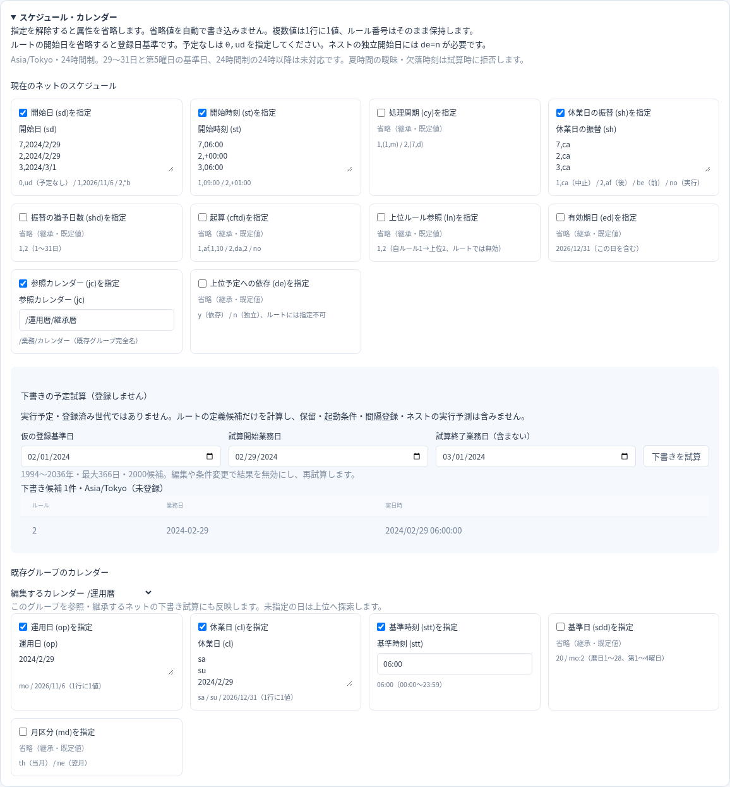

祝日は月表示で日付を選び「この日を休業日」で指定する。対象ネットがカレンダーを参照または継承し、運用日指定（sdの*指定）で予定を組む場合、その日を候補から除外する。毎日指定ではsh=ca（中止）なら休業日を除外し、sh=no（実行）は明示的に休業日も実行する。月表示で見える休業日の設定だけで全ジョブを強制停止するものではない。国民の祝日の自動取得・自動登録は行わない。休業日の判定は実日時でなく業務日を使う。48時間制の前業務日24時以降の予定は、実日時が祝日でも前業務日のカレンダーに従う。

下書き保存・試算・ダウンロードでは運用は変わらない。「運用反映の差分を確認」から反映して、通常の未開始予定を再計算する。開始済み・結果不明・個別運用操作済みの世代は既存の保護方針を維持する。

受入: 月表示で平日を休業日に変更し、曜日の運用指定より日付例外が優先されること、参照先の上位カレンダーを継承すること、試算・保存再読込・出力再取込・運用反映後の確定予定から当日が除外されることをPlaywrightで確認する。実時刻の待機や本番用の時計APIを追加せず、制御時計を使う実Storageのエンジン試験で休業日には運用日/sh=caのジョブが起動せず、次の稼働日に起動することを日数/件数方式で検証する。sh=noの毎日予定は対照例として休業日にも実行する。

画像は2026年11月17日をテスト上の休業日にした操作例であり、実際の国民の祝日一覧ではない。

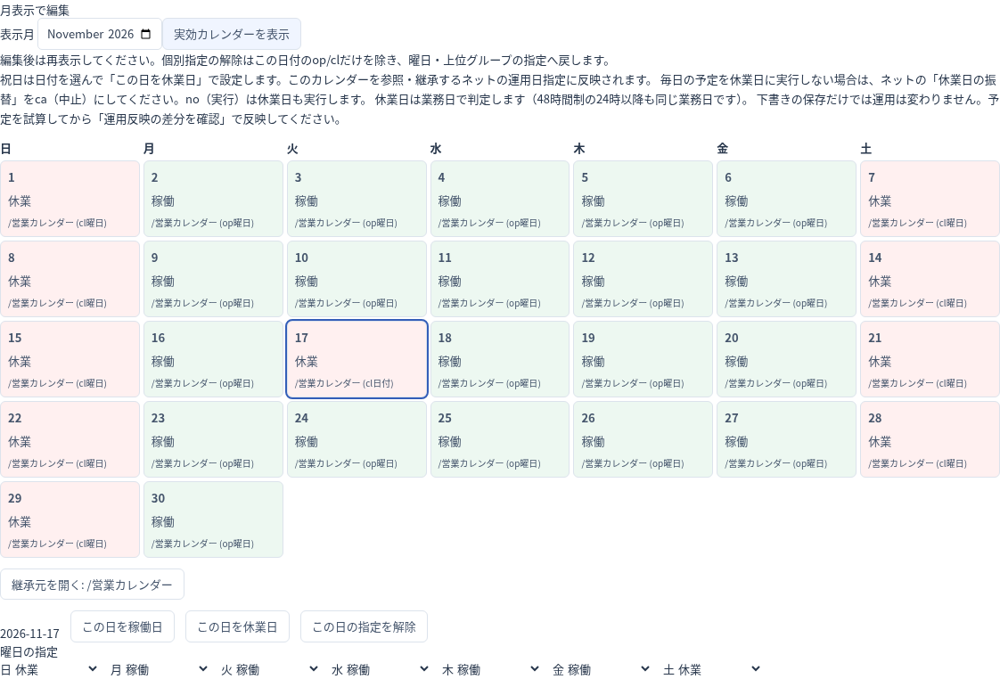

### ローカルUnit定義の下書き入力

- 単一または複数のUnit定義を、ファイル別の文字コード・論理配置先・元ファイル対応付きで開く。BOMのない入力の文字コードは明示し、自動推測しない。UTF-8、UTF-16LE/BE、Shift_JISを扱い、BOMと指定が矛盾する場合や不正バイトは拒否する。
- JobRunnerの出力ZIP（manifest.json形式1）も読める。ZIPはメモリーだけで処理し、未掲載エントリー、重複パス、絶対パス、ドット区間、バックスラッシュ、シンボリックリンク、壊れたZIPとCRC不一致を拒否する。元ファイル対応の重複・危険なパスと論理配置先の不正も拒否する。
- 入力は最大32ファイル、1ファイル2MiB、合計8MiB。ZIP自体は8MiB、展開後も同じ原文制限、manifestは256KiBまで。ローカル読込APIのHTTP要求上限は12MiB。版9では他の編集POST/PUTも12MiBに制限する。原文は64階層・1ファイル10000ユニットまでとし、再帰解析前にも制限する。画面・API両方で制限し、途中までの入力を採用しない。
- 原文バイトは下書きとともにIndexedDBへ保持する。検証・出力・試算は毎回原文を検証し、定義ハッシュの不一致を拒否する。保存済み定義Blob、採用・登録・実行データには書き込まない。既存のサーバー定義下書き・旧要求を維持する。
- 現在の下書きを置き換える前に明示確認する。失敗・取消・読込中の編集では現在の下書きを保持する。置換保存も同じ保存世代比較を使い、別タブの保存を上書きしない。ローカル入力を採用定義の変更と誤表示しない。
- ZIP以外のアーカイブ、別形式Schedule/Calendar、汎用ZIP、ディレクトリ読込は対象外。参照エラーは既存エンジンの全体検証で拒否する。単一出力のバイト列と複数出力ZIPの対応を再取込で確認する。
- 試算条件をA→B→Aへ戻しても、破棄した応答に対応する実行中表示を復活させない。

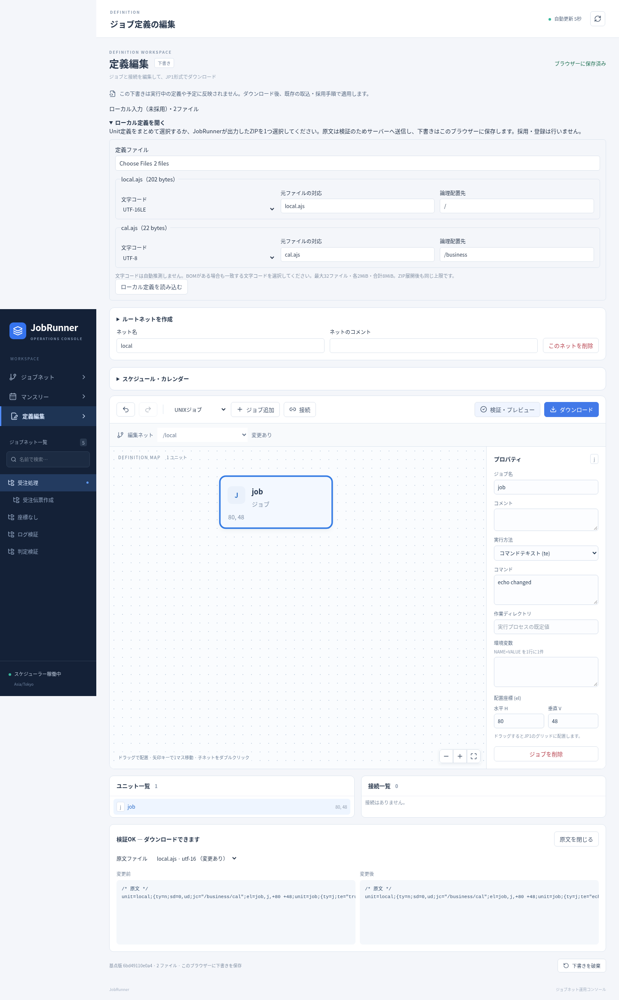

### 実行属性の下書き編集（版5）

- 版5は実行属性をExecutionへ独立して投影する。j/pj/rj/rpはha/jd/wth/tho/etm/ex、n/rnはha/mp/sy/ey/fd/ex、jdj/rjdjと原文のあるgはexを対象とする。判定ジョブのhaは既存の属性編集を継続する。原文のない仮想グループは対象外。
- 省略と明示値を区別する。空文字・空配列・重複した単一属性・未知属性・不正な対象IDは拒否する。sy/eyの複数ルールと順序、未変更の引用・表記を保つ。ha/mpはy/n、jdはcod/nm/ab、etmは1〜1440、wth/thoは既存エンジンの非負Int32とwth<=tho、fdと相対遅延は1〜2879、監視ルールは1〜144、絶対時刻は00:00〜47:59。ルートのM/Uは既存検証に従い拒否する。
- exはLocalAgentsへ設定済みの名称だけを受け入れる。ローカルの現在のOSユーザーで実行する対応付けであり、リモート転送やOSユーザー切替を提供しない。明示した空の名称は拒否する。
- 新規ルートの初期値ha=yを版5にも明示し、フォームからnへの変更または省略による解除を可能にする。出力だけでは採用・登録・実行へ反映しない。
- 版1〜4のAPI要求は従来の属性範囲だけを編集し、今回の追加属性を削除しない。ブラウザーの旧下書きは元のDefinitionHashの原文から版5へ補完する。ローカル下書きは保存済みLocalSourcesから補完し、採用中の版を基点にしない。既存の編集・属性削除・改名・追加・削除・予定・カレンダーを保持する。元版不一致・読込失敗時は保存を停止し、競合保護を維持する。

根拠: V12 3021-3-D28-20 5.2.4（ha/mp/sy/ey/fd/ex）、5.2.6（ha/jd/wth/tho/etm/ex）。属性編集・下書き版・LocalAgents対応付けはJobRunner独自契約。ha=w/a、jd=mdf/exf、マクロ、リモート実行など既存エンジン未対応の意味は追加しない。

受入: 全対象種別の省略/明示・境界・不正値・注入・ID整合性、未編集の原文/文字コード、親子改名/追加/削除との併用、旧要求と旧ローカル/サーバー下書き、検証/出力/再取込、予定試算、運用データ不変、保存復元/undo/redo/複数タブ競合を検証する。

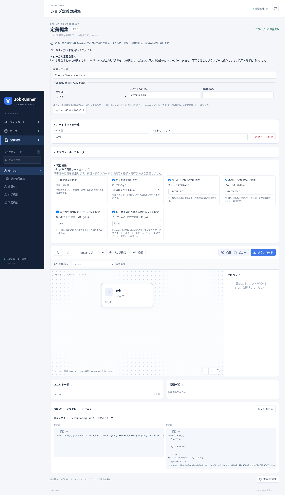

### グループ・Unitファイルの追加（版6）

- 既存ファイルの配置先または同じファイルのグループへ空のgを追加できる。原文の属性・文字コード・BOM・配置を維持し、版6では既存グループの改名・削除・移動を提供しない（改名・削除は版7で拡張）。仮想グループとの名前衝突も拒否する。
- 新規Unitファイルはローカル下書きだけへ追加する。ファイル名、論理配置先、UTF-8/UTF-16LE/BE/Shift_JIS、BOMの有無、初期グループ名を明示する。初期内容は空グループで自動実行されない。空のローカルファイルから開始する操作は既存下書きの置換確認を伴う。
- 新しいグループをカレンダー・実行属性・新規ルートネットの親として編集できる。追加候補は全体検証に通ってから反映する。元原文と追加記述を分離し、undo/redo・再読込・旧版移行・複数タブの競合保護を維持する。
- 追加時は既存ローカル入力と同じパス・文字コード・件数・バイト・階層上限を使う。追加グループは1000個まで。既存ネット内、別ファイルの内部グループ、重複完全名、不明な親には作成できない。既存実行データ・採用・登録・Blobを変更しない。
- ネット外の単独ジョブも無変更で出力でき、固定された配置のまま実行属性を編集できる。

根拠: V12 3021-3-D28-20 5.1、5.2.1、5.2.3。複数ファイル配置、追加制限、下書き版はJobRunner独自契約。受入: 原文一致、各文字コード/BOM、親子追加と参照、拒否境界、旧下書き、保存競合、遅い検証応答、ZIP再取込、運用データ不変。

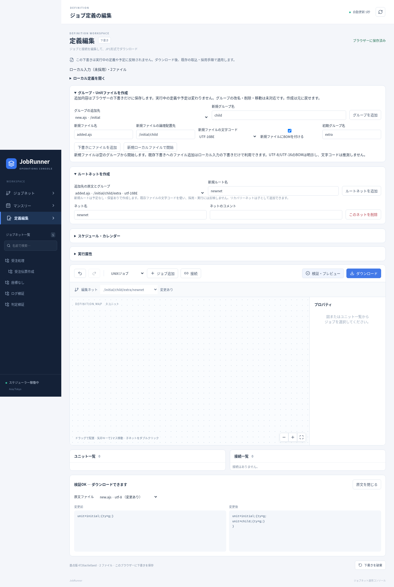

### グループの名前変更・削除（版7）

- 原文のあるグループ（追加したグループを含む）を安定した元パスで識別し、同じ親・同じファイルで名前変更できる。子孫の名前・属性・親子関係、カレンダーの継承を保ち、既知のjc完全名参照と親のel表示参照だけを追従させる。コマンド・コメント・環境変数等の文字列は変更しない。
- グループ削除は明示確認後に子孫ごと下書きから削除する。残るネットのjcが削除対象を参照する場合は拒否し、先に参照を解除・変更する。ファイルが空になる削除は拒否し、同じファイルに代替ユニットを作る。元に戻す・やり直す・再読込と保存競合を保護する。
- 独立ファイル（追加ファイルを含む）のTargetPathと同じか、その祖先のグループは名前変更・削除できない。ファイル配置を推測で移動しない。原文のない仮想グループ、既存名の再利用・名前交換、解決できない表示参照も理由付きで拒否する。操作は1000件・変更後の完全名は1024文字まで（JobRunner独自制限）。グループ移動・種別変換は対象外。
- 編集内容は原文の構造・属性編集後に適用する。元のIDとファイル対応を保持し、画面の完全名・カレンダー・実行属性・試算には変更後の名前を使う。旧版1〜6の下書きは追加済みファイルや属性の省略も保持して移行する。
- 新規ローカルファイルの未定義配置先は既存読込と同じ、属性のない仮想親グループとして補う。既存の非グループを祖先として使う場合は拒否する。新規ファイル追加で元ファイルのバイト・対応・参照を変更しない。

根拠: V12 3021-3-D28-20 5.2.3（カレンダー、省略時の上位継承）、5.2.4 jc（グループ完全名）。編集操作・安定ID・ファイル境界の拒否はJobRunner独自契約。受入: 親子改名とjc/el、継承前後の試算一致、原文/文字コード、削除と外部参照/独立ファイル/空ファイルの拒否、旧版と履歴・競合・遅い応答、検証/出力/再取込と運用データ不変。

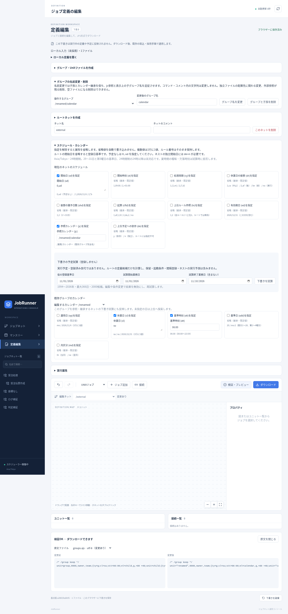

## ネットの移動・通常/リカバリー切替（版8）

- 版7までの原文と安定IDを保つ追加操作として記録する。ルートの移動は通常ネットを同じ原文ファイルのグループまたはそのファイル配置先へ移す場合に限定する。子孫の定義ブロックをそのまま移し、接続・属性・文字コード・BOMを削除/変換しない。元の親elは移動先へ移す。物理的な移動先がなく表示参照を保持できない場合は拒否する。ブロック外のコメントは元の位置に残す。
- 移動元と先の祖先チェーンから、カレンダーop/cl/stt/sdd/md、ex、所有者・許可・資源グループの明示値を比較し、空のグループを除いた順序も同じ場合だけ許可する。意味が同じでも表記や継承階層の定義が違うケースは保守的に拒否する。jcの明示だけでこの条件を省略しない。ネットの親子関係は変えず、ln/deとM/U監視の意味を保つ。
- 子ネットのn/rn切替は、親と子孫と全属性を維持する。接続は自動削除しない。条件接続が対象に入る切替、先行なしのrn化、リカバリーから通常への不正な後続接続は拒否する。確認画面に通常→rnでは通常先行の異常終了時に起動すること、rn→通常では通常の成功条件へ変わることを表示する。子孫の種別は一括変更しない。
- 候補をサーバー検証した後、移動前後の完全名または種別、属性・接続の削除なし、コマンド文字列のパスは自動書換えしないことを確認して適用する。取消・遅い応答・検証中の追加編集では候補を適用しない。履歴と保存競合保護を維持する。
- 別ファイルへの移動、子ネットの別親への移動、ルート/子の相互変換、ネットとジョブ間の変換、独立ファイルの配置先への影響、名前衝突は拒否する。採用・登録・世代・定義Blobは変更しない。

根拠: V12 3021-3-D28-20 5.2.2 ty=n/rn、5.2.3 カレンダー継承、5.2.4 ln（上位ルール対応）と既存エンジンの接続/リカバリー判定。移動・切替UIは独自の下書き契約で、JP1コマンド互換ではない。受入: 無変更/局所編集/移動ブロックのバイト保持、移動前後の試算一致、種別と接続の境界、旧版1〜7の移行、親グループ改名との併用、undo/redo・保存復元・競合・遅延応答、出力再取込と運用データ不変。

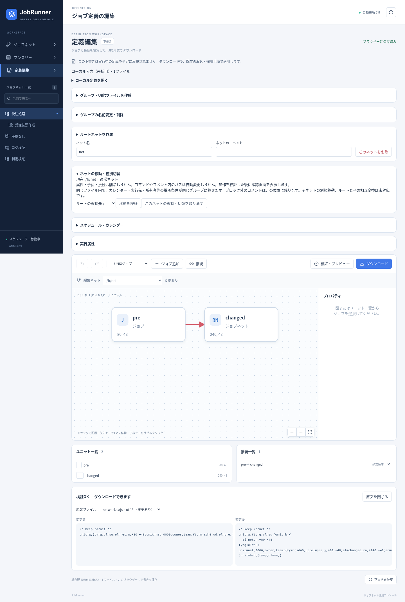

編集・検証・出力・予定試算の測定条件と規模別の制約は[性能記録](performance.md)を参照する。入力上限の全組合せや多数同時要求の応答時間を保証するものではない。

## グループ・ルートの自由な移動と依存付きZIP

現行のグループと通常ルートの移動は[移動仕様](../editor-moves/spec.md)を参照。別ファイル・独立ファイルの子孫を含めて配置と既知の参照を追従し、省略は移動先から継承する。版9下書きの任意RootOriginsに元のルート完全名を保存し、再投影と運用反映へ引き継ぐ。旧下書きは元版から対応を求める。依存付きZIP版2では外部jcを保持し依存先を同梱しない。不足を下書きで保持できるが、完全検証までは運用反映できない。

## ジョブ・子ネットの選択移動

版9の選択移動では、現在のネット直下の単体/複数ジョブ・子ネットを別ネットへ移せる。図でCtrl/⌘+クリックして選択し、移動先ネットを選んで候補を確認する。内部接続・子孫・種別・座標を保持し、範囲外接続の切断と継承変更を確認してから一つのundo操作で適用する。ルートとの相互変換は行わない。無効候補、原文保持とファイル所属、運用反映の保護は[移動仕様](../editor-moves/spec.md)を参照。候補の古い応答、遅い保存中のundo/redo、複数タブ競合では現在の編集と保存状態の対応を維持する。

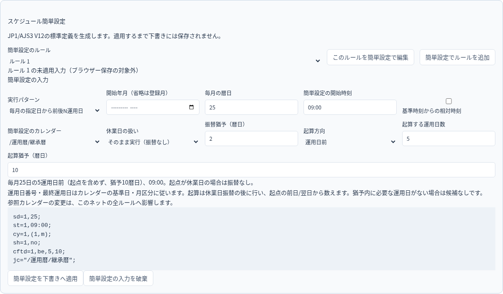

### ネストの簡単設定と上位連動試算

- 通常/リカバリーのネスト全階層で既存の簡単設定を使う。新規ネストは従来どおり上位依存とする。de省略/yは上位の予定を使用し、独自ルール・カレンダー入力を無効にする。de=nでは独自ルールとlnの上位対応を編集する。新規lnの初期値は自ルール番号と同じとし、親が上位依存ならさらに祖先の有効ルールを表示する。存在しない対応先は警告し、親の定義を自動変更しない。
- 依存の切替はネットの全ルールに影響する。独自から上位依存への適用では併用できないsdの削除を確認し、他の合法な未編集属性を残す。一回のundoで戻せる。省略と明示、原文バイト、文字コード、監視、旧下書き、競合と遅延応答の保護を維持する。ジョブへのスケジュール属性の追加や単独実行登録はしない。
- POST /ui/definition-editor/nested-schedulesは既存のEditorScheduleRequest（下書き、ネットID、仮登録日、開始/排他終了業務日）を使い、ルート安定ID/パス、時間帯、判定付き行と祖先経路を返す。既存のルート試算API・editorVersion・保存形式は変更しない。
- 試算と世代生成で同じ純粋な選択処理を使う。各ルート候補から上位依存/独自設定、ln、同一業務日、基準時刻を順に評価する。時刻条件を満たす候補の中から最早日時、同日時なら小さいルール番号を採用する。祖先が対象外なら子孫も対象外。同日でも別ルート候補は別行とし、ルート予定のない業務日にも理由を表示する。
- 表示はスケジュール上の対象・上位予定なし・対応ルール不一致・同じ業務日の候補なし・基準時刻条件不一致・祖先対象外を区別する。リカバリーネットは異常時のみ起動することを明記する。先行完了、異常発生、起動条件、保留/停止を含む実開始の予測は行わず、採用/登録/実行/Blobへ書き込まない。最大366日・2000行・計算5秒・要求取消を適用し、超過時に部分結果を返さない。
- 根拠: V12 3021-3-D28-20 5.2.4 de/ln、3021-3-D23-30 3.5.3、3021-3-D27-30 12.3.16/17。受入: 親子/孫の依存と独自設定、親予定なし、未対応ルール、最早/同時刻、時刻不適合候補との同日時、暦・起算・48時間、親子改名/移動、原文保持、undo/redo・保存/再取込・競合/遅延応答、試算と実Storage世代の一致、再起動・保留/取消・二重起動防止を検証する。

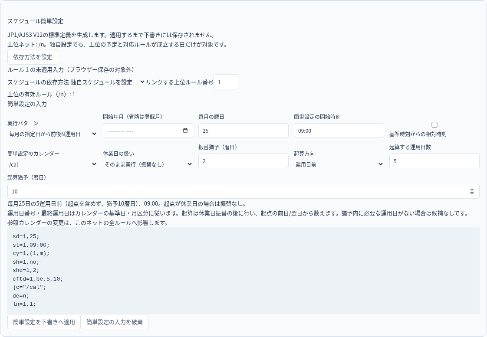
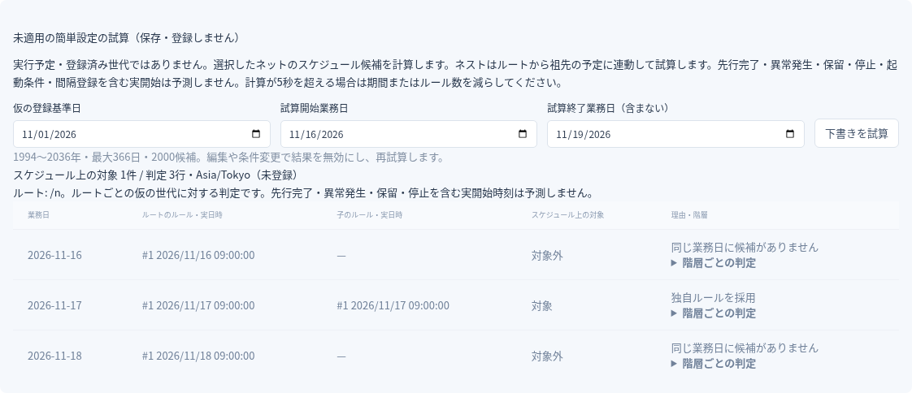
